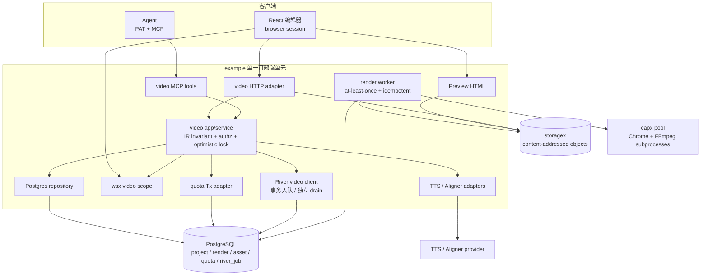

# Video Studio 领域架构与实施基线

> **版本**：v2.0（2026-11-15 代码审计与业界实践修订）
> **初始版本**：2026-11-14
> **当前状态**：**部分实现，尚未形成可运行闭环，不满足部署验收条件**（2026-11-14 审计时状态，已过时——见 §0.5 现状校正）
> **2026-11-17 状态更新**：v2 重构方向已立项（IR v2 契约 / 烘焙层 / 音频多轨 / 探针环 / 引擎渲染器），见 `plan-video-studio-ir-v2-2026-11-17.md` 与 `plan-video-studio-ir-v2-spec-2026-11-17.md`；本文 §5 IR 契约为 v1 现行契约，v2 落地后由 v2 spec 接管
> **审计范围**：`platform/capx`、`example/internal/video`、example 装配与 OpenAPI、UI 路由、quota / authz / storagex / wsx / mcpx / events
> **说明**：本次审计时相关代码仍处于工作区演进中。本文同时记录目标架构、已实现现状和合入阻断项；实施时以函数名和契约为准，不以旧行号为准。

---

## 0. 执行摘要与审计结论

### 0.1 保留的主架构

以下方向经过代码核对和业界实践比较后保留：

1. **单一可部署单元**：Go 同进程 API + River worker，Chrome / FFmpeg 作为受管子进程；后续可拆远程渲染。
2. **`platform/capx` 抽象浏览器渲染与 FFmpeg**：视频产品不直接绑定 chromedp。
3. **IR → 自包含 HTML + GSAP → 固定帧截图 → H.264**：预览和出片共用 Player，避免双实现。
4. **内容寻址资产、IR 快照、异步渲染**：渲染不受后续编辑影响。
5. **River 事务性 enqueue + 幂等 worker**：按 at-least-once 执行设计，而不是宣称 exactly-once。
6. **REST 全量编辑 + MCP 细粒度写操作**：两者汇入同一领域服务，共享校验、权限、审计和推送。

### 0.2 必须修正的关键设计

原方案不能直接进入生产实施，需落实以下修订：

| 优先级 | 修订 | 原因 |
|---|---|---|
| P0 | TTS / Aligner 移出 `SELECT FOR UPDATE` 事务 | 外部调用最长 60s，长事务会放大锁等待、连接占用和超时回滚 |
| P0 | 配额消费、render 行、River job 同一 DB 事务；终态释放也同事务 | 避免扣费未入队、重复释放、跨月释放错账 |
| P0 | 所有入口统一 `authz.CanIn`；MCP 的 PAT scope 只是凭证收缩，不替代角色权限 | 仅校验 membership 会使角色表和 workspace scope 失去服务端意义 |
| P0 | 统一 `durationFrames = ceil(durationSec * fps)` | 当前 app 截断、JS 四舍五入、原设计向上取整三种口径并存 |
| P0 | 移除 `video_project.script` 与 IR 内重复 version 的真值歧义 | 当前 service 更新 `ir.script` 但不更新冗余 `script` 列，读取会返回旧值 |
| P0 | 渲染提交增加客户端幂等键 | `expected_version` 不能防止网络重试创建两次渲染、重复扣配额 |
| P0 | 渲染 worker 使用独立停止窗口，不套用 events 的 45s drain | 30s 视频渲染约 2–4min，45s 会使发布必然中断在途任务 |
| P1 | 词锚点改为稳定 `wordId`；nearest 只能显式修复，不能静默挂接 | 文本或索引不是稳定身份，自动 nearest 可能把效果移到错误语义位置 |
| P1 | 增加 `schemaVersion`、render recipe、资产清单和 renderer 版本 | 仅保存 IR 快照不足以解释或复现一次出片 |
| P1 | 资产登记与对象授权分离；禁止只凭 key 前缀授权 | 删除、GC、跨项目引用、撤销访问和内容类型都需要数据库依据 |
| P1 | `PoolSize` 必须是硬并发上限；浏览器 launch timeout 与 job 生命周期分离 | 当前 channel 空闲池不是信号量，可能无限 launch；20s launch context 也不能覆盖长渲染 |
| P1 | 未知 IR 类型在 preview 可警告，在 render 必须 fail closed | 静默跳过会生成“成功但内容缺失”的视频 |

### 0.3 当前代码真实状态

| 领域 | 已存在 | 尚缺 / 当前问题 |
|---|---|---|
| 数据模型 | `1005_video_project`、`1006_video_render`、`1008_video_quota_keys` | 无资产登记表；有重复 script/version；缺 render recipe、提交幂等键、heartbeat 等 |
| IR 与 app | 类型、校验、锚点、Service、projector、字幕、单元测试 | 外部合成在锁内；授权不足；提交非原子；参数校验和帧数口径不完整 |
| capx | gating、Chrome 探测、FFmpeg 探测、renderer、encoder、测试 | 奇数尺寸测试失败；浏览器池不是硬上限；资源就绪错误会被吞掉 |
| HTTP / MCP / preview / WS adapter | OpenAPI 和 UI 调用已部分加入 | **main.go 未装配，路由未注册，MCP / WS scope 未注册** |
| render worker / TTS / Aligner | 仅有 port 和默认值 | 无生产实现 |
| UI | 列表页、工作室页、路由与 sidebar | 后端未挂载，不能形成端到端验收；仍有 Slider / WS ScopePrefix TODO |

### 0.4 审计时执行的验证

| 命令 | 结果 |
|---|---|
| `go -C example test ./internal/video/app` | 通过 |
| `go test ./platform/capx ./example/internal/video/app` | 失败；example 是独立 module，不能从根 module 以该包路径测试；同时 capx 多个 1×1 编码用例因 H.264 奇数尺寸失败 |
| `python tools/check_api.py` | 失败：spec 172 条、代码 161 条；11 条 spec-only 全部为 video API |
| `make verify` / `make verify-ui` / `make test-db` | 本次未运行；文档修订不代表这些门槛已通过 |

> 因此，本文不把“已有文件”视为“阶段已完成”。阶段完成必须满足第 16 节验收门槛。

### 0.5 现状校正（2026-11-17）

本节校正 §0.3 / §0.4 / §10.2 / 第 17 节中已过时的审计判断。历史审计内容**原样保留**（作为 2026-11-14 审计基线的记录，不回改），以下逐条给出 2026-11-17 真值。总体结论：视频域已全链路闭环——round9（2026-11-16）L0–L3 全量达成，九案合计 10,800/10,800 帧精确命中、0 帧偏差。

| 原审计判断（2026-11-14） | 出处 | 现状真值（2026-11-17） |
|---|---|---|
| “main.go 未装配，路由未注册，MCP / WS scope 未注册” | §0.3 表 HTTP / MCP / preview / WS 行 | 已装配：13 条 `/api/video` REST 路由（`example/internal/video/adapters/http/routes.go:78-91`，含 M3 批次的 templates / compose）、26 个唯一 `video_*` MCP 工具全部落地（30 个 mcpAdd 注册，见 `example/internal/video/adapters/mcp/tools.go`）；`python tools/check_api.py` = 175:175 零漂移 |
| “render worker / TTS / Aligner 仅有 port 和默认值，无生产实现” | §0.3 表 render worker 行 | 已实现：`example/internal/video/render/worker.go`、`render_pipeline.go`、`reconciler.go`；TTS（`adapters/tts/tts.go`）与 Aligner（`adapters/aligner/aligner.go`）降级矩阵落地（Synth→Aligner→Estimate 兜底，round9 关闭案例库 §8.5 未决项 1） |
| “UI 仅有页面骨架，后端未挂载，不能形成端到端验收” | §0.3 表 UI 行 | 已接线：`make verify-ui` 绿（round9 记录） |
| “check_api 失败：11 条 spec-only，F2 未形成闭环” | §0.4 表、第 17 节 F2 行 | `python tools/check_api.py` = 175:175 零漂移，spec-only 清零 |
| “F3 未实现生产 worker” | 第 17 节 F3 行 | round9 L3 九案全量 PASS（10,800/10,800 帧精确、合计 380s、几何 / fps 全对）；reconciler 真机首战零误判，并发提交、配额幂等台账验证通过 |
| “F0 部分实现（迁移与授权 / 原子性需修订）；F1 奇数尺寸测试失败” | 第 17 节 F0 / F1 行 | 已闭合：迁移 1009 / 1010 / 1011 落地（见 §11.1 现状回写）；capx 编码（含 1×1 / 奇数尺寸）用例当前通过 |

另两处注记：§10.2 的 MCP 工具表为设计期 11 工具子集（实际已落地 26 个，见 §10.2 头部注记）；第 17 节阶段表已逐行补「现状（2026-11-17）」列。§10.5 的裁定回写块（2026-11-16）保持不变。

---

## 1. 定位、目标与非目标

### 1.1 产品定位

视频工作室是多智能体产品的**视觉化 / 视频化输出引擎**：Agent 通过词级时间锚点操纵结构化 IR，在同一套 preview / render 语义下完成脚本、时间轴、动画、特效、配音、字幕和 MP4 导出。

### 1.2 v1 目标

- Agent 与自然语言工作流可创建、读取、修改、预览、渲染视频。
- 词级时间锚点在脚本重对齐后可追踪、可报告、可显式修复。
- 所有可变操作使用乐观锁；所有渲染提交使用幂等键。
- 同源 IR、同源 Player、同源资产清单驱动预览与出片。
- 配额、权限、审计、租户隔离在服务端强制执行。
- Chrome / FFmpeg 缺失时视频能力关闭，其余产品能力不受影响。

### 1.3 v1 非目标

- 任意 HTML / React / 用户 JavaScript 执行。
- 拖拽式专业剪辑器、多人同时编辑同一帧、多机位、色轮、曲线、关键帧编辑器。
- 远程渲染、分布式分片、硬件转码、多 Worker 调度、跨浏览器 bit-identical 承诺。
- 浏览器内精确 TTS 波形级试听；预览只提供时间轴和可选音频播放。

---

## 2. 架构决策

| # | 决策 | 理由 / 约束 |
|---|---|---|
| D1 | Chrome / FFmpeg 抽象进入 `platform/capx` | 多产品复用，业务域不得 import 平台 |
| D2 | River 事务性 enqueue，worker 全幂等；成功行与 `JobCompleteTx` 同事务 | River 官方语义为 at-least-once，唯一 job 也只保证插入唯一 |
| D3 | GSAP 3 + 固定 seek + 显式资源就绪门 | 预览 / 出片共用 Player；异步资源失败必须终止渲染，不能留空白帧 |
| D4 | 稳定 `wordId` 为引用身份，文本 / index 只是 Agent 选择器 | 避免脚本变化后静默错挂；重对齐采用 diff 映射与 unresolved 状态 |
| D5 | REST 粗粒度 IR 替换，MCP 细粒度领域方法 | 不为 10 种操作复制 10 条 REST 路径 |
| D6 | `authz.CanIn` 同时覆盖角色、PAT scope、workspace scope；video MCP 仅允许 PAT | membership 只解决租户成员身份，不能替代授权；PAT-only 缩小 CSRF 与浏览器 confused-deputy 面 |
| D7 | 配额 fail closed；plan / quota / IDR 中 `idempotency_recorded` 保留例外 | IDR 自身是配额机制，不能因“创建 idem 记录需要配额”形成自锁 |
| D8 | 三方注册表 append-only，并发变体 registry test | UI、渲染、MCP 使用同一类型真相 |
| D9 | quota 增加向后兼容的 Tx 变体，video 通过 port 使用 | 在不引入业务域横向 import 的前提下实现原子扣费 / 释放 |
| D10 | 单进程优先，独立 video River client 负责长任务超时和 drain；remote 是触发式 v2 | events 的 30s soft stop 不适合分钟级渲染 |
| D11 | IR 是创作状态唯一真值；项目行只保存标题、版本、时间等运营元数据 | 删除冗余 script 与 IR 内重复 version，避免双真值 |
| D12 | 渲染确定性按“固定渲染镜像 + 固定依赖 + 固定资产”定义 | 不承诺跨 OS / GPU / Chrome 版本 bit-identical；用可解释 recipe 和分层 golden tests 验收 |

涉及既有 ADR 0014 的范围变化（MCP 从 dev tool 扩展为产品能力）时，必须新增 ADR 或在 ADR 0014 增补决策，明确 PAT-only、工具限流、审计和生产暴露边界；不能继续沿用“开发阶段无需工具限流”的豁免。

---

## 3. 总体拓扑



“单进程”指**一个可部署业务单元**，不否认 Chrome / FFmpeg 子进程。多副本部署时，`MaxWorkers=1` 只限制**每个 River client**，不保证全局串行；v1 若要求全局单渲染，应只在一个副本启用 `VIDEO_WORKER_ENABLED`，不能把队列配置误写成全局锁。

---

## 4. 包布局与依赖边界

```text
platform/
  capx/
    capx.go / browser.go / renderer.go / encode.go / remote.go
    *_test.go
    gsap.min.js                       # vendored + LICENSE

example/internal/video/
  doc.go                              # 只描述已落地能力，不预写未来目录
  app/
    ir.go / ir_registry.go / wordref.go / subtitle.go
    service.go / ports.go / render.go
    projector.go / timeline-builder.js / player-shell.html
    *_test.go
  adapters/
    http/{routes.go,rest.go,upload.go,files.go}
    mcp/tools.go
    preview/html.go
    ws/publisher.go
    postgres/{project_repo.go,render_repo.go,asset_repo.go}
    quota/adapter.go                  # ConsumeWithTx / ReleaseTx
    riverjobs/{enqueuer.go,enqueuer_args.go}
  render/{worker.go,reconciler.go,recipe.go,assets.go}
  tts/{noop.go,http.go}
  aligner/{noop.go,http.go}

example/web/
  src/lib/api/video.ts
  src/pages/VideoStudioListPage.tsx
  src/pages/VideoStudioPage.tsx
  public/video/fonts/{NotoSansSC.ttf,OFL.txt}
```

硬约束：

- `video/app` 只 import `authz` 和 `platform/*` 的通用类型，不 import identity、quota、billing 或其他 example 业务域。
- quota、billing、identity 的具体适配只允许在 `adapters/*` 和 `main.go`。
- 新增通用能力必须同时有 example 消费与测试；`remote.go` 若仅有边界声明而无消费，文档必须明确“example 未接线”。
- `main.go`、OpenAPI、路由计数、MCP / WS 注册、UI 路由与 sidebar 在同一功能 PR 闭环，避免 spec 超前。

---

## 5. IR 契约

### 5.1 v1 示例

```json
{
  "schemaVersion": 1,
  "meta": {
    "width": 1080,
    "height": 1920,
    "fps": 30,
    "durationSec": 8.04,
    "background": "#101018"
  },
  "script": "欢迎来到我们的产品。",
  "voice": { "provider": "http", "voice": "zh-CN-XiaoxiaoNeural", "rate": 1.0, "audioKey": null },
  "words": [
    {
      "id": "w_01J...",
      "index": 0,
      "start": 0.0,
      "end": 0.32,
      "text": "欢迎",
      "source": "aligned",
      "confidence": 0.98,
      "scriptStart": 0,
      "scriptEnd": 2
    }
  ],
  "tracks": [
    { "id": "tr_main", "kind": "main", "z": 0 },
    { "id": "tr_bgm", "kind": "bgm", "z": -1, "volume": 0.15, "assetKey": null }
  ],
  "elements": [
    {
      "id": "el_title",
      "type": "text",
      "trackId": "tr_main",
      "startFrame": 0,
      "endFrame": 241,
      "params": { "text": "欢迎来到我们的产品", "x": 80, "y": 220, "fontSize": 64, "color": "#ffffff" }
    }
  ],
  "animations": [
    { "id": "an_1", "targetElementId": "el_title", "type": "fade_in", "startFrame": 0, "durationFrames": 24, "params": {} }
  ],
  "effects": [
    {
      "id": "ef_1",
      "type": "highlight",
      "anchor": {
        "wordId": "w_01J...",
        "lastText": "欢迎",
        "lastIndex": 0,
        "resolvedFrom": "exact",
        "status": "resolved"
      },
      "targetElementId": null,
      "params": { "color": "#ffd54a" }
    }
  ]
}
```

### 5.2 不变量

1. **时间基准**：`durationFrames = ceil(meta.durationSec * fps)`；合法帧为 `[0, durationFrames-1]`，`t = frameIndex / fps`。
2. **时长基准**：最终音视频统一 trim / pad 到 `durationFrames / fps`，不能只依赖 `amix.duration` 或 `-shortest`。
3. **尺寸**：产品 IR 的 width / height 必须为偶数，且处于 `{1080×1920, 1920×1080, 1080×1080}` 白名单；capx 作为通用包对奇数输入用 `pad=ceil(iw/2)*2:ceil(ih/2)*2` 处理并测试。
4. **标识**：element / animation / effect / track / word ID 在各自命名空间唯一；word.index 必须等于数组下标。
5. **版本**：`schemaVersion` 描述 IR 结构；项目行 `version` 描述乐观锁；两者不得混用。IR 内不再保存行级 version。
6. **兼容**：读取未知字段可保留；preview 对未知类型显示警告并跳过；render 遇到未知类型或不支持的 schemaVersion 必须返回 `E_VIDEO_UNSUPPORTED_SCHEMA`。
7. **上限**：IR ≤256KiB、elements ≤200（2026-11-18 自 128←64 二次上调，见 ir.go——gallery 展示片批 19 件作品的完整落件反馈需 171 元素）、animations/element ≤32（2026-11-17 自 16 上调，见 ir.go；进度条编排 15 段+淡出恰好卡满旧限，与 MaxElements 同理——计数是粗代理，非资源闸门）、animations/effects ≤128、script ≤2000 Unicode code points、durationSec ∈ [0.04,300]、fps ∈ {24,25,30,50,60}。v2 计划以资源预算（IR 字节 / 解码资产字节 / 像素）替代元素计数闸门，见 v2 spec（`plan-video-studio-ir-v2-spec-2026-11-17.md`）。
8. **资源上限**：单项目图片 ≤64，每个 data URI 解码后 ≤1MiB；总内联解码资产、上传文件、音频大小均有服务端上限，不能仅限制 JSON 字符串长度。
9. **缩放**：渲染参数覆盖分辨率时必须保持原宽高比，或显式提供 `fit=contain|cover`；v1 默认拒绝宽高比变化。
10. **规范化**：写库前使用统一 canonical JSON 生成 `ir_sha256`；不能只依赖 PostgreSQL JSONB 的键序行为。

### 5.3 词锚点与重对齐

**词是时间锚点，不自动等同于视觉目标。** `highlight` 若未提供 `targetElementId`，只表示舞台级时间效果；只有 Player 实现了词文本层时，才允许把效果渲染到具体词文本。文档和工具描述不得把“时间锚定”宣传为自动完成视觉锚定。

锚点解析顺序：

1. `wordId` 存在：作为唯一权威引用。
2. Agent 输入只有文本：精确匹配 + `occurrence`，重复词无 occurrence 时返回歧义错误。
3. 创建效果时不存在精确匹配：立即 `E_VIDEO_ANCHOR_NOT_FOUND`，不得自动 nearest。
4. `SetScript` 重对齐：用文本 diff / LCS 保留未变词的 wordId；新词分配新 ID。
5. 原锚点无法匹配：保留最后解析快照并标记 `unresolved`，返回 `warnings`；渲染前必须由用户确认或显式修复。
6. `nearest` 仅在工具参数 `repair=true, strategy=nearest` 时执行，并记录 resolvedFrom、距离和置信度；不得悄悄改变语义。

`scriptStart/scriptEnd` 统一为 Unicode code point 偏移，避免 Go byte、JS UTF-16、Python code point 三套索引混用。TTS 与 Aligner 的词文本必须通过确定性对齐器映射回 script，不能信任供应商顺序恰好等于源文本切片。

### 5.4 字幕

- 以 words 时间切分，支持标点分句、CJK ≤16 字 / 行、英文 ≤42 字符 / 行、最多两行。
- 最小显示时长、相邻 cue 间隔和跨句词组处理由单一 `BuildSRT` 规则决定。
- `source=estimated` 强制 soft subtitle 或明确的低置信提示；真实 TTS 存在时禁止无提示地用 estimated 替换真实时间。
- burn 失败可降级 soft，但写入 `warnings`，不能把正常降级塞进 `error`。

### 5.4a 2026-11-17 增量能力（versus 试点驱动）

> v0.32.0 落地的三项作者工效增量，全部为加法、不改既有契约；v2 语义归宿见 `plan-video-studio-ir-v2-spec-2026-11-17.md` §2.8。

1. **atFrame 帧锚**：`ElementAnimation` 可带整数 `atFrame`（全局时间线帧号，与 §7.0 裁定的词锚同一时钟），作为词锚之外的显式锚定方式。语义要点：
   - 与 `startAnchor` **互斥**，写时校验（两者同给或锚整体缺失 = `E_VIDEO_IR_INVALID` 硬错误）；
   - 边界 `atFrame == F`（该动画合法的最后一个全局帧）**合法**；
   - **v1 词锚路径原样保留**——未带 `atFrame` 的动画走既有词锚解析/回退，完全向后兼容；
   - 试点动因：30 件贴纸被迫造 37 个 manual 假锚词，同刻起跳的对子还要 +0.031s 错峰绕开词表单调性校验。v2 迁移时升格为必填 `at: {frame} | {wordId}`（v2 spec §2.8.1）。
2. **resize 动画类型**：宽高 tween，`From`/`To` Point 携 (w,h) 像素。**语义显式声明：左上角锚定，宽度增长向右扩展**（进度条语义）——与 `move` 的**中心坐标语义**刻意不同。这一原点不一致是 v2 要统一的历史包袱（v2 spec §2.8：move 定为绝对中心坐标，元素 x/y 维持角点原点），v1 期间两者并存、各自文档化。试点对照：进度条不再拆 30 个手算窗口 shape，单元素 15 段 resize 链 + 淡出即成（也是 MaxAnimationsPerElement 16→32 的直接动因，见 §5.2 第 7 条）。
3. **target-less shake = 整画布相机的既有语义澄清**（X-4 语义钉住）：不带 `targetElementId` 的 `pulse`/`shake` 作用于 `#canvas` 整层（timeline-builder 的既有回退分支）——即「相机震动/全画布脉冲」在 v1 本就可表达，无需新能力。versus 试点曾误判「相机震动不可表达」而把震动烘焙进贴纸；实为既有能力，特此钉住——工具描述与后续文档不得再把它宣传为缺口。

### 5.4b 2026-11-17（晚）增量能力（11 片全量复刻摩擦驱动）

> v0.33.0 落地的六项能力，来源是 11 个 TikTok 概念片全量复刻的 FRICTION.md 实测清单（`tool-site/.runtime/videos/*-pilot/FRICTION.md`）；全部为加法，**旧 IR 投影逐字节不变**（双 agent 各自以 fixture SHA-256 前后比对固化，`TestProjector_LegacyPayloadByteIdentical` 钉住）。

1. **元素 `transformOrigin`**（CSS transform-origin 字符串，默认空=50% 50%）：scaleIn/rotate/pulse 继承节点 style——消灭「中心缩放锚点补偿数学」整类作者负担（turn/spotdiff 两个试点手推公式的教训；builder 中 scaleIn/rotate 写死的 '50% 50%' 已删）。
2. **元素 `clip`**（固定相机窗）：`{x,y,w,h,radius}` 画布坐标。**实现为 untransformed wrapper**（`#clipwrap-<id>` 定位窗几何 + inset(0 round)，元素在内做 scaleIn/move/rotate——窗恒定）：实测 clip-path 挂节点会随节点自身 transform 移动（scale=2 时窗坐标被缩放），wrapper 是唯一正确形态。spotdiff 的「卡框+框内运镜」从每 punch 烘独立整卡变为单房间图+clip。**clip 与 mixBlendMode 组合时 blend 上移 wrapper**（clip-path 自成隔离组，组内 blend 静默失效——实测）。
3. **元素 `mixBlendMode`**（15 值 CSS 白名单）+ `#canvas isolation: isolate`：day 的色温系统（multiply 调色+screen 光斑）从 5 张整卡状态烘焙变为 5 个全屏色罩元素。
4. **品牌字体进 IR**：顶层 `fontAssets: [{key,family,weight}]`，key 走 video/ 登记校验（validateAssetRefs 纳入）、上传白名单 woff2（magic bytes "wOF2"）、projector 注入 @font-face（fonts.ready 门），preview CSP 补 `font-src 'self'`。polished 的计数场景从 31 张 PNG 窗口链（31/92 元素）变为原生 text。
5. **counter 增强**：params 增 `format`（字面模板 `"0:{v}"`→"0:23.92"）与 `decimals`；**Effect 增 `atFrame`**（与动画同语义：与词锚互斥、ResolveAll 跳过词解析）——speedrun 计时器不再 PNG 步进、counter 不再绑词表。
6. **`render.ProbeFrames` 转正**（探针一等化）：`ProbeFrames(ctx, ir, assets, frames, opts)` = 投影+SnapshotMulti 单入口（帧界校验、非 capx stub 返回 ErrNotConfigured）。DOM 断言暂留 inspectable-tab 模式（probe_types 注释指路）——11 片作者各自手搓 dump+seek 探针的时代结束。
7. **杂项**：easing 白名单 + `power2.inOut`（顺手修了 pulse 第二腿用白名单外缓动的 v1 隐性 bug）；fps 白名单 + 18/20（原片帧号对齐，省 50% 升帧成本）。

### 5.4c 2026-11-18 样式层（gallery 展示片设计批）

> 来源不是复刻摩擦而是**设计需求**：tool-site 的 15 条 gallery 用户作品片要按「一眼惊艳」的标准重做视觉，而此前的「好听好看」全部依赖"把字效/背景烘成 PNG"（Baloo 2 标题、渐变底、胶囊按钮都是死像素）。本批把这三类视觉原语收进 IR——**原生表达、可参数化、可批量**。全部字段 omitempty，旧 IR 投影逐字节不变（`TestElementMap_StylingPassthroughOnlyWhenSet` 钉住）。

1. **text 样式**（text 元素）：`fontFamily`（必须命中 fontAssets 注册族或内建 `Noto Sans SC Sub`，写时校验——未注册族会静默回落，属于"渲染成功但长得不对"的典型坑）、`fontWeight`（100–900）、`letterSpacing`（px）、`lineHeight`（无单位倍数）、`textAlign`、`strokeColor`+`strokeWidth`（成对出现；`-webkit-text-stroke` + `paint-order: stroke fill`——浏览器实测：没有 paint-order 时居中标描边会把 104px 字形掏空，见 `testdata/style-layer/frame-F000.png`）、`textShadow`（单层，`{color,x,y,blur}`）。
2. **元素 `opacity`**（静态 0..1，全元素类型）：气泡/光罩的常驻半透明不再需要 rgba 颜色技巧。0 与缺省同为 1.0（omitempty 的零值不可表达"不可见"——与音量字段同款注记；真不可见用时间窗）。
3. **shape `gradient` + `radius`**：`{type:linear|radial, angle, atX, atY, stops[{offset,color}]}`（≤8 色标、offset 非递减、色值走 `validCSSColorRe` 白名单——渐变串是拼进 style 声明的 CSS 注入面，与既有 `color` 单属性赋值不同）；`radius` 指针类型（0 可表达，nil=v1 的 8px 默认）。
4. **像素证明**：`TestStyleLayerRender`（capx）三岛断言——渐变顶红底蓝、圆角角落露背景、24px 描边外扩且白填充存活（paint-order）、0.5 透明度混出中灰。
5. **配套资产**：品牌字体走既有 `fontAssets`（gallery 用 Baloo 2 variable woff2 → `video/showcase/baloo2.woff2`）；气泡环/暗角/颗粒都能用原生 shape 叠加表达（渐变+screen/overlay blend），背景不再需要整幅烘焙。

已知边界：文本仍是单节点（无逐词 span），`highlight` 的 text-color 语义按整元素生效；渐变/描边色仅支持 hex 与 rgb()/rgba() 数值通道（不允许 CSS 变量或颜色名）。

### 5.4d 2026-11-18 动效层（展示片"极致"批）

> 用户对展示片的裁决是「视觉体验一定要极致」——5.4c 解决了"能画出来"，本批解决
> "动起来的高级感"。四项能力全部原生、全部有像素证明。

1. **逐词成句 `textReveal`**（text 元素）：`{style: rise|pop, atFrame, durationFrames, staggerFrames, easing, distance}`。builder 把 text 按空白切成 inline-block 词 span，每词一条 fromTo + 一个 t=0 的起点 set（反向 seek 确定性），作者只写一句话，词距/换行/对齐仍归浏览器排版。
   **关键坑（浏览器实测）**：`rise` 走 `top`（相对定位）而**不走 transform**——子 span 上任何 transform（含 identity translate）都会打碎父元素 `background-clip:text` 的渐变裁剪（渐变被画到元素左缘、文字错位）；`pop` 需要 scale（必须 transform），所以写时禁止 `pop`+`textGradient` 组合。
2. **渐变文字 `textGradient`**（text 元素）：复用 Gradient 结构，`background-clip:text` 填充字形。与 `strokeColor` 互斥（描边盖在裁剪填充之上 → 空心字，写时拒绝）。
3. **呼吸辉光 `glow` 特效**：`{color, blurMin, blurMax, periodFrames}`，text-shadow 在 blur 区间 yoyo 往复；repeat 由剩余时长算成有限次（确定性），t=0 set 兜底反向 seek。必须有 targetElementId。
4. **相机推进 `groupScale` 动画**：`{pivot:{x,y}, fromValue, toValue}`——tween 起点把元素 transform-origin 改写成"枢轴在元素盒内的百分比"，N 个元素共享枢轴同时序 = 一次运镜推进（"无相机/组变换"缺口的 v1 平替）。缩放为 1 时改 origin 无视觉位移，"入场弹入用自身中心、随后运镜换共享枢轴"可安全叠加；fromValue 应等于静止缩放（同 resize 链式约定）。
5. **像素证明**：`TestDesign2Render`（capx）四岛——逐词 f0=0/f10=6121/f29=12386、渐变红上蓝下、共享枢轴 1.5× 双块外扩（原位置归零）、辉光最强帧 halo 14.6×。
6. **样板**：Ocean World 展示片（8s/1080×1920）——钩子两行（首帧常驻 + 逐词 pop）、纸卡托起、10 件落件星芒、活计数 HUD、4s 起共享枢轴运镜、渐变作品名 + 逐词 rise + 呼吸辉光、CTA 脉冲、程序化音轨。

### 5.4e 2026-11-18 逐字与卡内装饰（设计批 3）

1. **`textReveal.split`**：`words`（默认）/`chars` 逐字。chars 模式把每个词包进 inline-block 词壳（保住按词换行）、字 span 在壳内逐字动画——英文 display 标题的"字字升起"由此原生表达；中文标题不用（逐字会碎）。
2. **卡内装饰的裁剪几何**：`clip` 窗口必须对齐**视觉实心区**，不是图片元素盒。card.png 这类"纸卡+烘焙投影"的素材，投影占了四周 ~50px；按元素盒裁剪会让窗内装饰（扫光）画到投影区，在暗底上读起来像漏到卡外。样板里用 `PAPER` 矩形（PNG 内 50..843/50..755 映射到画布）做窗口。
3. **clip wrapper 加固**：wrapper 同时写 `clip-path` + `overflow:hidden` + 同半径 `border-radius`，窗外元素 `will-change: auto`（窗内每帧 seek 重绘，合成层无收益，反而多一个"合成层 vs 祖先裁剪"的变量）。
4. **配套设计件**：扫光（卡内斜向白光带 sweep）、手绘下划线（resize 左锚点扩宽 + 圆角渐变）、背景星尘（小 radial 光点 + 长时程 move）——全部原生，无新烘焙。

### 5.4f 2026-11-18 3D 微倾（设计批 4）

1. **`tilt` 动画**：`From/To` 的 Point 复用作 `(rotateXdeg, rotateYdeg)`；共享 `pivot` 时与 groupScale 同一套 transform-origin 改写。`#canvas` 补 `perspective: 1600px`——**每个子元素的 3D 变换走同一个投影矩阵**，因此 N 元素同枢轴同角度 = 刚性整组倾斜（纸卡+贴纸一起"呼吸"）。2D 变换不受 perspective 影响（z=0），旧 IR 逐像素不变。
2. **幅度纪律**：±1–2° 是"悬浮感"，超过 ~6° 开始可见剪切（近大远小在平面贴纸上会穿帮）。样板用 Y 轴 ±1.2°、X 轴 ±0.8° 的两段回摆，从最后一个落件弹入结束（F124）之后才开始——避免改写 transform-origin 干扰落件自身的弹入缩放。
3. **像素证明**：`TestDesign2Render` 的 tilt 岛——520px 条形绕共享枢轴 rotateY 35°，投影宽度 519→441（0.85），面积 -33%。
4. **配套设计件**：钩子第二行逐字母 pop（chars）；每件贴纸落地 4 颗粒子沿对角迸出（0.2s 消散，纯原生 shape+radial 渐变）。

### 5.4g 2026-11-18 音乐网格进 IR（hypit 时序模型借鉴）

**动机**：展示片要做到"画面与音乐同一张拍点表"。第一版把网格放在 tool-site 的
JS 常量模块里由两个脚本 import——这解决了漂移，但 IR 里仍是绝对帧号，换 BPM 要
改 N 处。hypit（`D:/code/aihypit/hypit`）的 `packages/temporal` 给了更干净的
模型：**时刻是引用**（`program/selection/segment/moment` + offset），不是秒；它的
`@claim!` Moment 是"一个命名语义点，graphics/sound/effects 可同时响应"。

本批把这个模型搬进 IR（SQL 里叫加法，v1 向后兼容）：

1. **`ir.beats`**：`{bpm, phaseFrame, bars, moments[]}`。moment = 命名拍点
   （`{id, bar, beat}`，`beat` 可为 3.5 这类半拍）。
2. **`atBeat` 锚**：元素动画与特效可写 `{"moment":"pop-03"}` 或
   `{"bar":1,"beat":2,"offsetFrames":2}`——与 `atFrame`、`startAnchor` 三选一；
   同时给 `atFrame` 时必须与网格解析结果一致（幂等复核，重复 Validate 不误报）。
3. **解析在投影期**：`Projector.HTML` 先调 `ResolveBeats`，把 `atBeat` 算成
   `atFrame`——投影文档永远是平帧时间轴，builder 与既有消费者零改动。
   公式单一真源：`beatFrame = phaseFrame + round((bar*4+beat) * 60/bpm * fps) + offsetFrames`。
4. **音轨读 IR**：`bake-showcase-audio.mjs` 不再 import 网格模块——BPM 取自
   `ir.beats.bpm`，落件时刻取贴纸元素的 `startFrame`，作品名/CTA 取各自元素窗口。
   JS 生成器写窗口用的 `beatFrame()` 是 Go 公式的镜像，由
   `TestBeatGrid_ShowcaseParity` 用同一组帧号（45/53/60/68/75/83/90/98/105/113）钉死。
5. **语义修正**：旧版落件间距是 7/8 帧交替（为凑整帧手工补的八分网格补丁），
   新版按**纯半拍**（`beat+0.5`）表达——语义正确，取整误差 ≤0.5 帧由 round 吸收。
6. **测试**：`BeatFrame` 数学、showcase 帧号对账、atBeat 校验（无网格/未知 moment/
   bar 越界/与 atFrame 不一致/与词锚互斥）、幂等解析、投影载荷只含 atFrame。

**边界**：hypit 的 Moment 还承载叙事语义（claim/verdict 这类），我们只用了它的
时间层；没有做 BPM 检测——网格仍是作者声明，但已是一等数据，将来接 onset 分析
只需生成 beats 块，消费者不变。

### 5.4h 2026-11-18 词级 moment 与渐变逐字 pop（设计批 7）

1. **`BeatMoment.Word`**：moment 除 bar/beat 外可挂 `{text, occurrence}` 词锚——
   解析时读 `ir.Words` 的 start 时间（`round(start*fps)`），即 hypit 的
   "anchored to words instead of seconds"。写时校验词必须存在（`findWord` 与
   词锚解析同一套匹配：精确 token 优先、再按包含）。样板把 `hook-hit` /
   `title-hit` 两个 moment 改为词锚：将来接旁白或改台词，挂在它们上面的卡入场、
   运镜、标题、辉光、彩带全部自动跟随。
2. **渐变 + 逐字 pop 共存**：此前 `pop`（scale）与 `textGradient` 互斥，因为
   span 上的 transform 会打碎父元素的 `background-clip:text`（文字被画到元素
   左缘）。实测解法：**渐变改由每个词/字 span 自持**（span 自己有 clip 时
   transform 正常）。竖向渐变（180deg）逐字重画与整行连续渐变视觉等价；
   横向渐变会逐字重新起坡——文档注明，校验不再拒绝该组合。
3. **收尾彩带**（纯设计件）：16 片圆角小纸片从顶部撒下，旋转 + 横向漂移 +
   尾部淡出，`z=105` 压在 CTA 之上；全部原生 shape + move/rotate/fadeOut。
4. **测试**：`TestBeatMoment_WordAnchor`（词锚解析 + 缺词拒绝）；
   `TestDesign2Render` 的渐变岛改为"渐变 + chars pop"，像素断言仍按红上蓝下
   （证明 per-span 渐变在 transform 下渲染正确）。

---

## 6. app/service：所有入口的唯一写路径

### 6.1 端口

```go
type Authorizer interface {
    Authorize(ctx context.Context, p *webx.Principal, workspaceID, permission string) error
}

type QuotaPort interface {
    ConsumeWithTx(ctx context.Context, tx pgx.Tx, p *webx.Principal, workspaceID,
        key, idem string, cfg ConsumptionConfig) (ConsumeResult, error)
    ReleaseTx(ctx context.Context, tx pgx.Tx, workspaceID,
        key, period string, amount int64) error
}

type RenderJobs interface {
    InsertTx(ctx context.Context, tx pgx.Tx, args RenderJobArgs, opts *river.InsertOpts) error
}
```

`ConsumptionConfig` 和 `ConsumeResult` 均为 app 自己定义的 port 类型，实际实现由 adapter 转换；不得让 app import `quota` 业务包。

装配时 `Pool / Repo / Authorizer / Quota / Enqueue / Audit` 为必需端口，nil 应启动失败；Publisher 可为 nil 并退化为轮询。**当前 `Enqueue=nil 仍插入 queued` 和 `Quota=nil 跳过扣费` 必须删除**，否则与 fail-closed 决策冲突。

### 6.2 `Mutate` 规则

- 每次调用重新加载项目、执行 `authz.CanIn`、行锁、expectedVersion 校验、纯内存 mutation、全量校验、锚点重解析、更新、审计同事务。
- `fn` 必须是纯函数，禁止外部 I/O、TTS、对象存储、WS、sleep。
- 冲突统一 409 `E_VIDEO_VERSION_CONFLICT`，审计 `video.project.mutation_failed`，不保留已执行一半的副作用。
- commit 后 WS 仅 best-effort；断线重连通过全量 refetch 恢复，不为临时推送引入额外交付保证。

### 6.3 `SetScript` 两阶段流程

```text
读取项目 + 授权 + 保存 expectedVersion / 旧锚点
        │
        ├─ provider 未配置 → EstimateWords
        │
        └─ provider 已配置 → TTS / Aligner（事务外、独立 timeout）
                    │
                    ├─ 生成 content-addressed voice 对象
                    └─ 失败 → E_TTS_UNAVAILABLE / E_ALIGNER_UNAVAILABLE
                              仅 allowEstimated=true 时显式降级
        │
        ▼
短事务 Mutate：重取项目 → 再验版本 → 纯函数更新 IR → 审计 → commit
        │
        └─ 版本冲突：返回 409；未引用语音对象由 GC 清理
```

“环境未配置 → 静默降级”和“已配置但供应商故障 → 明确报错”必须区分。后者只有调用方显式 `allowEstimated` 才允许降级，避免 Agent 把估算时间误认为真实配音时间。

### 6.4 授权矩阵

| 操作 | 权限 | 额外约束 |
|---|---|---|
| 列表 / 详情 / preview / 文件读取 / render 查询 | `video:read` | workspace + project 归属 |
| 创建 / 修改 / 删除项目 | `video:write` | DELETE 有 active render 时 409 |
| 提交渲染 | `video:render` | 同时消耗配额、校验 schema 和资产 |
| MCP video 工具 | 上述权限 + PAT | session / PAT-all 按策略拒绝；`X-Workspace-Id` 必须在 PAT 授权范围 |

REST、MCP、文件下载均调用同一 Authorizer。平台管理员若需跨租户支持，应使用明确、审计的 break-glass 路径，不得在 video service 中隐式绕过。

---

## 7. 渲染提交：配额、快照、任务的原子边界

### 7.1 提交流程

1. 校验 `Idempotency-Key`（REST）或 `request_id`（MCP）、expectedVersion、RenderParams、schema、资源总量和 render 配额。
2. 生成 renderID；同一 workspace + submission key 的重复请求直接返回既有 render。
3. 在**一个短 DB 事务**中：
   - 重取项目并校验 workspace / version；
   - `ConsumeWithTx(..., idem="video.render:"+renderID)`；
   - 固化 IR、projectVersion、quotaPeriod、render recipe、资产 manifest；
   - 插入 `video_render(status=queued)`；
   - `River.InsertTx`，UniqueOpts 以 renderID 参数为唯一键。
4. 任一步失败，行、job、配额计数一起回滚。
5. commit 后审计和 WS；不要在事务中调用 capx、对象存储或 WS。

quota 需要提供 `ConsumeWithTx` / `ReleaseTx` 的向后兼容变体，复用现有 `quota_consume_idem`，无需为 video 新增 framework 配额表。`ConsumeResult.Replay` 由 adapter 转换；调用方不能把 replay 当作新消费。

### 7.2 渲染快照与 recipe

`ir_snapshot` 只回答“渲染了什么”；`render_recipe` 回答“用什么渲染”。recipe 至少包含：

```json
{
  "schemaVersion": 1,
  "projectVersion": 7,
  "irSha256": "...",
  "projectorVersion": "git-sha-or-build-version",
  "capxVersion": "git-sha-or-build-version",
  "chrome": "pinned-full-version",
  "ffmpeg": "pinned-full-version",
  "gsap": "3.15.0",
  "fonts": [{ "id": "noto-sans-sc", "revision": "sha256:..." }],
  "assets": [{ "key": "video/ws/assets/sha256/...", "sha256": "...", "size": 12345 }],
  "params": { "width": 1080, "height": 1920, "fps": 30 },
  "subtitleMode": "soft",
  "createdAt": "RFC3339"
}
```

不记录 secret、完整 TTS endpoint、presigned URL 或原始脚本到日志；script 只存在于受授权保护的 IR 快照。

---

## 8. render worker：幂等、重试与关闭

### 8.1 独立 River client

video 使用第二个 River client，共享 DB pool，不共享 events 的停止窗口：

| 配置 | 建议默认 | 说明 |
|---|---:|---|
| queue | `video` | 与 events 队列隔离 |
| MaxWorkers | 1 | **每进程**并发；不是全局串行 |
| MaxAttempts | 2 | 仅 transient error 重试；永久错误首次即终态 |
| Worker Timeout | 15min | 必须大于产品允许的最大渲染预算 |
| SoftStopTimeout | 15min | 停止获取新 job，等待在途渲染 |
| shutdown supervisor | soft stop + ≥15s | 部署器 termination grace 必须覆盖最终持久化 |

主进程的 events 仍按自身 45s 窗口 drain；video client 单独 `Stop` 并等待 `Stopped`，然后才能关闭 DB pool。硬取消时 worker 必须传播 `ctx.Err()`，不能返回成功或使用会永久取消任务的 API。

### 8.2 状态机

```text
queued ──claim──> running ──输出已落对象 + DB 成功事务──> succeeded
  ▲                 │
  │                 ├─ transient error 且仍有 attempt ──> queued / retryable（配额保留）
  │                 ├─ shutdown cancellation ───────────> queued / retryable（配额保留）
  │                 └─ permanent / attempts exhausted ──> failed（同事务释放原 quotaPeriod）
  └─ reconciler 发现 DB 有 queued 但 River job 缺失 ──────> 事务补入队
```

- 不使用 `running.updated_at < now()-10min` 直接判死；长渲染合法，River 自带 rescue 和 job timeout。
- progress 按时间节流（建议 2s）并更新 heartbeat；同一 attempt 单调，跨 attempt 必须携带 attempt，避免旧进度覆盖新进度。
- 输出先写临时文件，再 Put 到确定性 key；DB 成功更新前不把部分文件标记为成功。
- 成功终态：`video_render=succeeded` + 输出元数据 + `river.JobCompleteTx` 同一事务。提交失败后重试会覆盖同一确定性输出，不增加配额。
- 失败终态：`video_render=failed` + `ReleaseTx(original quotaPeriod)` + `JobCompleteTx` 同一事务，保证释放一次。
- 所有终态写入使用 `WHERE status IN ('queued','running')` 的条件更新并检查 affected rows；已经是终态时直接跳过。worker 与 reconciler 重入不得重复释放配额或覆盖成功结果。
- reconciler 处理“进程崩溃且未执行终态逻辑”的少数情况：对照 River discarded / cancelled 状态补业务终态；不得仅按视频行时间猜测。

### 8.3 Worker 步骤

```text
LoadRender + 校验 workspace / snapshot / recipe
  → 若已成功且对象可验证：直接完成（幂等短路）
  → claim running / 记录 attempt
  → 收集并验证资产 SHA-256、大小和 MIME
  → RenderHTML（内联 data URI + 固定字体）
  → capx.RenderFrames → PNG pipe → EncodePNGStream（临时文件）
  → MixAV / Subtitle / Thumbnail（按实际输入分支）
  → Put(output + thumb + 可选 srt)
  → 终态 DB 事务 + JobCompleteTx
  → commit 后 publish / audit
```

错误返回结构化为 `error_code` + 可展示、脱敏的 `error`；Chrome / FFmpeg stderr、供应商响应和 URL 只进入受限日志，且必须截断。

---

## 9. Projector 与 capx 契约

### 9.1 自包含 Player

`RenderHTML` 只消费 IR + data URI 资产：

- vendored GSAP + timeline builder，不加载 CDN、远程字体或远程脚本。
- `document.fonts.ready`、所有图片 decode、player ready 共同构成资源门；任一必需资源失败设置 `__player.error` 并使渲染失败。
- 图片 decode 不得空 catch 后继续出片；preview 可显示占位错误，但 render 必须 fail closed。
- Player 禁用 `Date.now`、随机数、wall-clock timer 作为画面来源；随机值由 IR 或固定 seed 生成。
- `seek` clamp 到 `[0,durationFrames-1]`；`play` 是预览功能，`seek` 是出片功能。播放时通过 `onUpdate` / rAF 回流当前帧，不能只在 play 开始时发一次状态。
- 固定字体 revision 和许可文件。字体子集必须覆盖所有受支持字符；缺字应检测并失败，不能依赖服务器上不可控的 fallback 字体。

CSP 基线：

```text
default-src 'none';
script-src 'sha256-<player-bootstrap>' 'sha256-<gsap-builder>';
style-src 'unsafe-inline';
img-src data: blob:;
font-src data:;
media-src 'self' blob:;
connect-src 'none';
frame-ancestors 'self';
base-uri 'none';
form-action 'none'
```

`script` 块只放 GSAP / builder / 静态 bootstrap，IR 放在非执行 JSON 块。JSON 使用 `encoding/json` 默认 HTML 转义，并验证 `</script>`、U+2028 / U+2029 注入测试；禁止 `template.HTML` 绕过上下文转义。

### 9.2 capx 接口

```go
RenderFrames(ctx, spec RenderSpec, html []byte, onFrame func(Frame) error) error
EncodePNGStream(ctx, r io.Reader, w io.Writer, spec VideoSpec) error
NewFrameWriter(w io.Writer).WriteFrame(png []byte) error
MixAV(ctx, spec MixSpec) error
BurnSubtitles(ctx, in MixIn, srt []byte, outPath string) (hard bool, err error)
ExtractThumbnail(ctx, in MixIn, tSec float64, outPath string) error
Available() bool
Close() error
```

- PNG pipe 使用明确长度前缀和流式 reader，不在内存中保存整段视频。
- `onFrame` 同步写 pipe，产生自然 backpressure；不得另起无界 goroutine。
- 每次截图显式指定 `format=png`、`clip(x=0,y=0,width,height,scale=1)`、`fromSurface=true`、`captureBeyondViewport=false`、deviceScaleFactor=1。
- double-rAF 只是经验性同步手段，不是跨环境像素一致性的数学保证；必须通过固定镜像 golden tests 验证。
- 网络域先 enable，再阻断 `http/https/ws/wss`；data / blob 是否可用必须有专门测试，不能简单用 `"*"` 后假设内联资源仍能加载。
- 浏览器 launch 的 20s context 只负责启动；长 render context 独立于 launch context，Close 必须完整释放 allocator、browser 和 tab。
- PoolSize 用带 context 的 semaphore 限制在途实例；空闲 channel 只负责复用，不负责并发上限。
- Chrome 以 root 运行需要 `--no-sandbox` 时，必须限定在隔离渲染容器、非 root 用户或 Seccomp 策略中，不能把关闭 sandbox 当作普通开发默认值。

### 9.3 FFmpeg 合成

- 所有参数通过 `exec.CommandContext` argv 传递，不经过 shell；滤镜路径、subtitle path 使用固定临时工作目录和正确的 filter escaping。
- H.264 + yuv420p 对奇数尺寸统一 pad；产品层仍只允许偶数标准尺寸。
- 有 voice + BGM 时使用 `amix=inputs=2:duration=longest:normalize=0`，避免默认 normalize 改变人声音量；随后 `apad`、`atrim`、`aresample=48000`。
- BGM 短于视频时显式 loop / pad；无 voice 或无 BGM 时走独立滤镜分支，不构造不存在的输入。
- 可选响度目标：`loudnorm=I=-16:TP=-1.5:LRA=11` 后重采样到 48kHz；recipe 记录实际滤镜链和 FFmpeg 版本。
- 输出明确 `-frames:v` / `-t`、`-preset medium`、`-crf 18`、`-pix_fmt yuv420p`、`-movflags +faststart`。
- 无 libass 时 burn → soft + warning；不重复 mux 已损坏的输出。

---

## 10. REST、MCP 与 preview 协议

### 10.1 REST

| Method | 路径 | 说明 |
|---|---|---|
| GET | `/api/video/projects?limit=&cursor=` | 列表，默认 50、最大 100 |
| POST | `/api/video/projects` | 创建 |
| GET | `/api/video/projects/{id}` | 详情，返回 row version + IR |
| PUT | `/api/video/projects/{id}/ir` | 全量替换；`expected_version` 必填 |
| DELETE | `/api/video/projects/{id}` | 有 active render 时 409；对象进入 GC |
| GET | `/api/video/projects/{id}/preview.html` | no-store + CSP |
| POST | `/api/video/projects/{id}/renders` | `Idempotency-Key` 必填；202 |
| GET | `/api/video/projects/{id}/renders?limit=&cursor=` | 分页历史 |
| GET | `/api/video/renders/{id}` | 状态、attempt、progress、warnings、output |
| POST | `/api/video/assets` | multipart；project_id + file；服务端计算 SHA |
| GET | `/api/video/files/{fileID}` | Range / 206；fileID 为不透明资源标识，不接受原始对象路径 |

**路由修订**：Go ServeMux 的 `{key}` 只匹配单段，原设计与 `video/<ws>/...` key 冲突；OpenAPI 与当前契约检查器也不应依赖非标准 `{key...}` 路径表达式。本文改用不透明 `fileID`：由服务端签发，可取严格 base64url 编码的对象 key 或资源 ID + 用途，解码后仍必须查询资产 / render 归属并授权。OpenAPI 与 Go 路由统一使用字面路径 `/api/video/files/{fileID}`。

文件响应：校验资源归属后 `http.ServeContent`；使用检测后的可信 MIME、`X-Content-Type-Options: nosniff`、合理 Content-Disposition。授权可撤销的内容不使用一年私有缓存；建议 `private, max-age=300` 或对敏感内容 `no-store`。Range 与 presigned URL 不能绕过权限。

### 10.2 MCP 工具（共 11 个）

> **[现状校正 2026-11-17]** 实际已落地 **26 个唯一 `video_*` MCP 工具**（30 个 mcpAdd 注册），完整清单见 `example/internal/video/adapters/mcp/tools.go` 与 `docs/plan-video-studio-agent-tools-2026-11-16.md`。下表为设计期子集，仅保留对照价值，不反映现状工具面。

所有写工具除 create 外均接受 `expectedVersion`；service 可以兼容 optional，但 MCP schema 必须标记 required。所有响应包含最新 version 和 warnings。

| 工具 | 权限 | 必要输入 / 说明 |
|---|---|---|
| `video_list_projects` | read | limit / cursor |
| `video_create_project` | write | title / meta / script 可选 |
| `video_inspect` | read | `view=summary|ir|words|assets`，避免一次把 256KiB 全塞入上下文 |
| `video_set_script` | write | script + expectedVersion + voice/rate + allowEstimated |
| `video_set_words` | write | words（含稳定 ID）+ expectedVersion；禁止无审计覆盖 |
| `video_add_element` | write | type/params/trackId/startFrame/endFrame + expectedVersion |
| `video_add_animation` | write | targetElementId/type/startFrame/durationFrames + expectedVersion |
| `video_add_effect_at_word` | write | wordId 或 text+occurrence/type/params/targetElementId + expectedVersion |
| `video_move_effect` | write | effectId + 新锚点 + expectedVersion |
| `video_render` | render | request_id + expectedVersion + params |
| `video_upload_asset` | write | project_id + base64 ≤700KiB；大文件走 REST |

MCP 适配器每个 tool call 重新 `Authenticate`、`RequireWorkspaceScope`、构造 Principal、调用 `authz.CanIn`，不得缓存授权结果。`video_*` 仅允许 PAT；不转发 PAT 给 TTS / Aligner，不在日志中记录 base64、script 全文或凭证。

`video_set_words` 的破坏性与 `video_set_script` 相当：警告文案不能替代权限、版本校验和审计。若希望 Agent 默认走安全路径，可将该工具设为 `repair=true` 时才允许全量覆盖。

### 10.3 WS

```json
{"type":"event","name":"video.ir.updated","payload":{"project_id":"...","version":8,"updated_by":"user","origin":"mcp"}}
{"type":"event","name":"video.render.updated","payload":{"render_id":"...","project_id":"...","status":"running","attempt":1,"progress":42,"output_key":null}}
```

- `wswire.RegisterScope("video")` 与 hub `video:<projectID>`。
- publish 在 commit 后 best-effort；version / attempt 防止旧消息覆盖新状态。
- 客户端 WS 断开时轮询 active render，重连后全量 refetch。
- 不在 payload 中发送完整 IR、脚本、凭证或 presigned URL。

### 10.4 preview postMessage

```text
parent → iframe: {type:"player", cmd:"seek"|"play"|"pause"|"getState", frame?}
iframe → parent: {type:"player:state", frame, t, durationFrames, ready, error?}
```

接收方同时校验 `event.origin === window.location.origin`、`event.source === iframe.contentWindow` 和消息 schema；不能只校验 origin。iframe 不加 sandbox 的理由是保留 same-origin 资源加载，因此 HTML 自身的 XSS 防护和 CSP 是强制验收项。

### 10.5 统一错误语义

> **[裁定回写 2026-11-16（案例库 §8.5a 采纳，round9 实施批）]** 本表为设计期草案；
> 实际返回的错误码以**代码 + openapi.yaml video 节定值表**为准（代码侧 9 个码，逐一
> file:line 见 openapi.yaml video 节头注释）。两案裁定：`E_TTS_UNAVAILABLE` /
> `E_ALIGNER_UNAVAILABLE` **永不返回**（降级矩阵 Synth→Aligner→Estimate 兜底，
> 供应商失败仅记日志，调用方以 words_source 判断来源）——本表 502 行仅作
> "未来 allowEstimated 闸门落地时"的预留定值保留。素材缺失按方案 B 收口：
> 悬空 image src 走写时校验 → `E_VIDEO_IR_INVALID`（details.field=elements[N].src），
> `E_VIDEO_ASSET_NOT_FOUND` 404 行**不接线**（该行随 render 终态 error_code 的
> P1 提案另议）。下表保留原始草案供对照，与实现分叉的行已加注。

| HTTP | code | 场景 |
|---:|---|---|
| 400 | `E_VIDEO_INVALID_IR` / `E_VIDEO_INVALID_PARAMS` | 设计期名——实际定值为 `E_VIDEO_IR_INVALID`（400，含 details.field；素材悬空 src 同挂此码，"asset not registered"） |
| 400 | `E_VIDEO_ANCHOR_NOT_FOUND` / `E_VIDEO_ANCHOR_AMBIGUOUS` | 实际仅 `E_VIDEO_ANCHOR_NOT_FOUND`（occurrence 越界落 same_text 最近候选，不报 ambiguous） |
| 400 | `E_VIDEO_UNSUPPORTED_SCHEMA` | 未接线（读时宽容跳过未知类型并 warn，前向兼容）——预留行 |
| 402 | `E_QUOTA_EXCEEDED` | hard quota 阻断 |
| 403 | `E_ACCESS_DENIED` / `E_WORKSPACE_SCOPE` | 设计期名——实际定值为 `E_FORBIDDEN`（workspace 成员校验）+ PAT scope 门（MCP requireToolScope） |
| 404 | `E_VIDEO_PROJECT_NOT_FOUND` / `E_VIDEO_RENDER_NOT_FOUND` / `E_VIDEO_ASSET_NOT_FOUND` | 前两者已接线；`E_VIDEO_ASSET_NOT_FOUND` 未接线（素材缺失归 `E_VIDEO_IR_INVALID` 写时校验，见上方裁定回写）——预留行 |
| 409 | `E_VIDEO_VERSION_CONFLICT` | expectedVersion 冲突 |
| 409 | `E_VIDEO_RENDER_ACTIVE` | 未接线（项目删除级联 renders，无 active render 拦截）——预留行 |
| 413 | `E_VIDEO_PAYLOAD_TOO_LARGE` | 设计期名——IR 总量超限归 `E_VIDEO_IR_INVALID`（256KiB 校验）；body 超限归全局 `E_PAYLOAD_TOO_LARGE` 闸门 |
| 429 | `E_RATE_LIMITED` | MCP / API / workspace 并发限制 |
| 502 | `E_TTS_UNAVAILABLE` / `E_ALIGNER_UNAVAILABLE` | **永不返回**（降级矩阵兜底；见上方裁定回写）——预留定值，待 allowEstimated 闸门 |
| 503 | `E_CAPABILITY_NOT_CONFIGURED` | 设计期名——实际定值为 `E_NOT_CONFIGURED`（渲染提交门；不建行不扣额） |
| 500 | `E_INTERNAL` | 未分类内部错误，仅返回脱敏信息 |

MCP tool result / error data 保留相同 `code`、可展示 message 和 `retryable`，不直接把 `webx.Error` 的 JSON tag 误当成 HTTP status 输出；REST 使用与项目现有错误信封一致的字段。

---

## 11. 数据模型与对象生命周期

### 11.1 迁移编号基线

当前已占用：产品迁移到 1008，其中 1005 / 1006 / 1008 已是 video，1007 是 RLS demo。**原 1001–1003 编号作废。**

- 若这些 video 迁移尚未合入 / 部署：直接修订 1005 / 1006，新增 1009 资产模型，避免制造 corrective migrations。
- 若任何环境已应用：不得修改已执行迁移；从当前最大编号之后新增 1009、1010……，并在实施前重新检查目录。

> **现状（2026-11-17 回写）**：上文「新增 1009 资产模型」是设计期编号假设，与实际落地
> 编号不符。`example/cmd/app/migrations/` 的实际占用是：
>
> | 编号 | 文件 | 内容 |
> |---|---|---|
> | 1009 | `1009_video_render_idem` | 渲染提交幂等 + 配额记账列（`submission_key` / `quota_period` / `UNIQUE(workspace_id, submission_key)`）；**不是**资产模型 |
> | 1010 | `1010_video_drop_script_column` | 删除 `video_project.script` 冗余列（IR 为唯一真相源，即 §11.2 的目标态） |
> | 1011 | `1011_video_asset` | 资产登记表 `video_asset`（F-AUTH-01 归属凭据） |
>
> 结论：§11 系列的编号以本表为权威，「1009 = 资产模型」的表述作废。后续新增产品迁移
> 从 1012 起；`video_asset` 的登记语义是**下载授权凭据**（`handleFile` 第三层校验，
> 缺登记行即 404），不是可选元数据索引——不要把它降级成"可选缓存"。

### 11.2 `video_project` 目标字段

- `id / workspace_id / title / ir / version / created_by / created_at / updated_at`。
- 增加 `ir_sha256`（或等价的规范化哈希列）用于 recipe 与审计。
- **删除 `script` 冗余列**；读取响应从 `ir.script` 派生。
- 行 version 是唯一乐观锁版本，IR 内只有 schemaVersion。
- `(id,workspace_id)` 唯一，供 render / asset link 使用复合外键，防止跨 workspace 错配。

### 11.3 `video_render` 目标字段

除原字段外增加：

- `submission_key`、`project_version`、`quota_period`；
- `attempt`、`heartbeat_at`、`started_at`；
- `ir_sha256`、`render_recipe`、`warnings`；
- `error_code` 与脱敏 `error`；
- `UNIQUE(workspace_id, submission_key)`；submission key 为空时允许普通历史行；
- status CHECK：`queued|running|succeeded|failed`；重试通过 running → queued 表达，不增加含义模糊的 interrupted 终态；
- `(project_id,workspace_id)` 复合外键，输出对象 key 不作为授权的唯一依据。

### 11.4 资产表与引用表

```text
video_asset
  id / workspace_id / sha256 / key / size / mime / kind
  created_by / created_at / last_verified_at
  UNIQUE(workspace_id, sha256), UNIQUE(key)

video_project_asset
  project_id / workspace_id / asset_id / created_at
  PRIMARY KEY(project_id, asset_id)
  复合 FK → video_project；FK → video_asset
```

上传或 TTS 生成流程：流式计算 SHA → 临时对象 → 校验 → Put 到 content-addressed key → DB 登记 asset + project link。若 DB 失败，临时 / 未引用对象由 GC 清理。

文件授权必须能追溯到：

1. asset + project link + `video:read`；或
2. render output + project + `video:read`。

仅比较 `video/<wsID>/` 前缀不足以防止错误登记、跨项目引用和未来 key 规则变化。

### 11.5 删除与 GC

- 项目存在 queued / running render 时 DELETE 返回 409，或先执行显式 cancel；不能删除项目后让 worker 继续写孤儿对象。
- 删除项目只删除 DB 引用，不直接在 DB 事务中删除对象。
- commit 后生成清理任务，经过安全宽限期删除无引用 asset、render output、thumb、临时文件。
- workspace 删除同样通过引用清单清理，避免对象存储泄漏。
- 清理任务本身幂等，对象不存在视为成功。

---

## 12. 安全、配额与滥用防护

### 12.1 上传

- 同时校验扩展名、声明 MIME、magic bytes 和实际解码；图片建议 PNG / JPEG / WebP 白名单。
- SVG / HTML 不作为普通图片内联；确需支持时使用独立受控转换，不在同源 inline 响应直接返回。
- 限制单文件、项目总字节、像素总量、音频时长和解码时间，防止 decompression bomb。
- 文件名不进入对象 key；key 只由 workspace、kind、服务端 SHA 和规范化扩展名组成。
- 日志不记录 multipart 内容、base64、完整 URL query 或供应商密钥。

### 12.2 限流与资源治理

- 复用 `webx.RateLimit` 为 `/mcp` 增加 per-principal 限制；生产配置不得沿用 ADR 0014 的开发期无限流豁免。
- 除月度配额外，增加 workspace 级 active render 上限、单项目时长 / 分辨率 / fps / 资产字节上限。
- Chrome、FFmpeg、TTS、Aligner 均有独立 timeout；渲染总预算覆盖所有阶段。
- 排队时间长、渲染慢、provider 不可用不能通过无限重试解决；MaxAttempts 和退避必须受限。

### 12.3 配额语义

- `video_renders_monthly` 统计“已预扣且未终态释放”的提交数；成功消耗 1，最终失败释放 1，重试不重复消费。
- quotaPeriod 在提交时固定，释放不能使用失败时的当前月份。
- 未声明该 metric 的 plan 默认拒绝渲染；free=0、pro=20 只是 example 配置，其他 plan 必须显式开通。
- soft 模式只告警不阻断；hard 模式返回 402 `E_QUOTA_EXCEEDED`。

---

## 13. 可观测性、审计与健康检查

结构化日志字段：`request_id / trace_id / workspace_id / project_id / render_id / attempt / capability / duration_ms / outcome`。禁止记录完整 script、凭证、对象 URL query 和未脱敏 stderr。

审计事件至少包括：

- project created / ir.updated / deleted；
- script realigned / words overridden；
- render submitted / succeeded / failed / interrupted；
- asset uploaded / deleted；
- mutation_failed / access_denied / quota_exceeded。

运维面板先复用 devx jobs，暴露 queue depth、running age、attempt、last error。若需要 Prometheus 指标，应优先扩展 `platform/metrics` 的 provider-neutral counter / histogram 并在 example 接线，不在 video 包手写第二套全局 meter。

健康检查：

- Chrome / FFmpeg 缺失不应拖垮整个产品 readiness；视频 capability 显示 disabled。
- 若部署把 video 声明为核心能力，则独立 video readiness 检查 River client、DB、对象存储和 capx 可用性。
- `/dev/doctor` 报告 Chrome / FFmpeg 版本、字体 revision、pool 配置和最近探测错误，不泄露路径中的敏感信息。

---

## 14. 环境变量与能力降级

| 变量 | 默认 | 说明 |
|---|---:|---|
| `CAPX_ENABLED` | false | 未显式开启时 Runtime inert |
| `CAPX_CHROME_PATH` | 空 | 空则探测系统 Chrome |
| `CAPX_FFMPEG_PATH` | `ffmpeg` | 不以 `CAPX_ENABLED` 覆盖既有探测语义 |
| `CAPX_POOL_SIZE` | 1 | 硬并发上限 |
| `CAPX_MAX_RENDER_SECONDS` | 900 | 单 attempt 总预算 |
| `VIDEO_WORKER_ENABLED` | false | 多副本只按需开启 |
| `VIDEO_RENDER_QUEUE` | `video` | River queue |
| `VIDEO_RENDER_MAX_WORKERS` | 1 | 每进程 worker 数 |
| `VIDEO_RENDER_JOB_TIMEOUT` | 15m | worker timeout |
| `VIDEO_RENDER_SHUTDOWN_TIMEOUT` | 15m | 独立 drain |
| `VIDEO_RENDER_MAX_ATTEMPTS` | 2 | transient retry |
| `VIDEO_MAX_IR_BYTES` | 262144 | 服务端也校验 |
| `VIDEO_MAX_UPLOAD_BYTES` | 10485760 | REST；MCP base64 更低 |
| `VIDEO_MAX_ACTIVE_RENDERS_PER_WORKSPACE` | 1 | 防队列滥用 |
| `VIDEO_TTS_URL` | 空 | TTS vendor base URL（`adapters/tts` 契约：`POST {base}/synthesize`）；空 = 未配置，降级 estimated |
| `VIDEO_TTS_KEY` | 空 | 可选 Authorization bearer（仅 env，不入库） |
| `VIDEO_TTS_VOICE` | 空 | 默认音色（请求可覆盖） |
| `VIDEO_ALIGNER_URL` | 空 | WhisperX sidecar base URL（`adapters/aligner` 契约：`POST {base}/align`）；空 = 未配置 |
| `PLOYKIT_MCP_RATE_LIMIT_PER_USER` | 生产必须 >0 | `/mcp` 工具入口限流 |

> **[2026-11-17 口径收敛]** 上表 TTS / Aligner 四行原写作 `VIDEO_TTS_PROVIDER` / `VIDEO_TTS_ENDPOINT / API_KEY / MODEL` / `VIDEO_ALIGNER_PROVIDER / ENDPOINT / API_KEY`（设计期设想的"供应商 + 端点 + 模型"三段式），但**实际适配器契约是单 URL 的 vendor/sidecar 协议**（`adapters/tts/tts.go:30-32`、`adapters/aligner/aligner.go:28`），设计期的三段式抽象从未实现。本表已改为实现真值，避免运维按未实现的变量名配置。另注（ADR 0017 边界声明）：这两个适配器**已实现但 example 不装配**——`main.go` 不构造它们，`Ports.Synth` / `Ports.Aligner` 恒 nil，故上述变量今天配置后**不生效**，`SetScript` 恒降级到 `words_source=estimated`；产品要在自己的组合根接线。

本表为视频实现的环境变量唯一口径；配套 compat 文档若仍使用 `PLOYKIT_TTS_*`、`FFMPEG_PATH` 或“尚未实施”的旧状态，应在功能 PR 同步更新，避免运维配置分裂。

---

## 15. 前端接线

- 页面路由只进 `example/web/src/routes.tsx`；菜单只进 `AppSidebar.tsx` 的 Components / UI 区。
- 加 `/video`、菜单项 `Video Studio`；顶部显式 workspace 切换器沿用 `useWorkspace()`。
- `@ploykit/ui` 尚无 Slider 时，原生 `<input type=range>` 只放页面层并标注待替换；不向未合入代码写 `range.tsx`。
- `ScopePrefix` 未包含 video 时先补客户端 union，删除 `as never` 临时断言后再验收。
- 渲染历史使用 WS + active poll 兜底；无 active render 时不做 1s 轮询。
- preview iframe key 由 project version 驱动；无版本变化不重复加载大 HTML。
- 字词点击只负责 seek；效果创建仍需 Agent 或明确 UI 操作，不能因“词锚点”名称暗示已有专业文字特效编辑器。

---

## 16. 测试与合入门槛

### 16.1 IR / service

- 三分方注册表并发读；重复 ID、非法 schema、非法尺寸 / fps / 时长 / 资源上限。
- `durationFrames` 在 Go、JS、FFmpeg 输入一致；1s@30fps、8.04s@30fps、60fps 边界。
- 锚点：重复词 occurrence、脚本插入 / 删除 / 替换、unresolved、显式 nearest、稳定 ID 保持。
- SetScript：外部调用不在 DB 事务内；provider 故障不静默估算；版本冲突不产生已登记语音引用。
- REST / MCP 同操作得到相同 IR、version、audit；session MCP video 被拒绝；PAT 跨 workspace 被拒绝。
- 角色 member 无 video:write 时即使持有任意 membership 也不能写；PAT 有 scope 但越 workspace 同样 403。
- 渲染提交重试使用同一 Idempotency-Key 只产生一行、一次配额、一个 River job。

### 16.2 capx / worker

- `RenderFrames` 第 0 / 中 / 末帧正确；资源失败、player error、网络阻断、字体缺字均失败。
- 同一固定镜像同 HTML 渲染 100 次逐字节一致；不同镜像只做视觉容差，不宣称 bit-identical。
- launch 超过 20s 后 job 仍能运行；PoolSize 压力测试证明在途实例不超过上限；Close 无进程泄漏。
- FFmpeg 1×1、奇数尺寸、无音轨、仅 voice、仅 BGM、短 BGM、响度链、burn 无 libass、特殊字符路径。
- `go test -race ./platform/capx`，重点检查 stderr buffer、pipe 和 pool。
- worker：插入后崩溃、输出后崩溃、DB commit 失败、终态重复执行、跨月失败、shutdown、River rescue。
- 断言“行、job、配额”在故障注入后最终一致，而非仅检查 HTTP 202。

### 16.3 安全与接口

- 预览 `</script>` 注入、CSP、外部请求阻断、postMessage 错 origin / 错 source / 畸形消息。
- 上传伪造 MIME、SVG、超限像素、路径穿越、key 前缀混淆、跨 workspace Range / 206。
- OpenAPI 与路由同 PR；fileID 对合法多段对象 key、非法 base64url、路径穿越和跨租户访问有集成测试。
- `tools/check_api.py` 当前只扫描框架 adapters、devx、main.go 和 task；F2 必须把 `example/internal/video/adapters/http/*.go` 加入 `SCAN_FILES`，否则 video 路由即使未接入检查也可能假绿。
- MCP base64 不进日志；pat-all / 错 scope 按统一拒绝规则测试。

### 16.4 总门槛

```bash
make -C example db-up
make test-db
make verify
make verify-ui
python tools/check_api.py
```

任何一项失败都不能把对应阶段标为完成。

---

## 17. 实施阶段与当前差距

| 阶段 | 合入内容 | 完成判据 | 当前判断 | 现状（2026-11-17） |
|---|---|---|---|---|
| F0 地基 | 迁移、IR、registry、字幕、authz、quota Tx port、repo | DB 集成测试 + 授权 / 幂等 / 配额原子性通过 | **部分实现**；app 单测过，但迁移与授权 / 原子性需修订 | 已闭合：迁移 1009 / 1010 / 1011 落地（见 §11.1 现状回写）；配额 / 幂等台账经 round9 并发提交验证 |
| F1 capx | 自包含 Player、池、编码、混音、缩略图 | capx 全测试、race、100 帧 hash、资源失败测试通过 | **部分实现**；当前奇数尺寸测试失败 | 已闭合：capx 编码用例（含 1×1 / 奇数尺寸）当前通过；round9 九案几何全对 |
| F2 API + MCP | REST、preview、MCP、文件授权、审计、WS | OpenAPI 零漂移，Agent 闭环和越权测试通过 | **未形成闭环**；11 条 spec-only | 已达成：check_api 175:175 零漂移；13 条 REST 路由 + 26 个 MCP 工具落地（见 §0.5） |
| F3 渲染闭环 | 独立 River client、worker、reconciler、TTS / Aligner、lifecycle | 故障注入、重试、配额、drain、Range 播放通过 | **未实现生产 worker** | 已达成：round9 L3 九案全量 PASS（10,800/10,800 帧精确）；worker / reconciler 落地，reconciler 真机零误判 |
| F4 UI | 路由、菜单、编辑器、播放器、渲染历史 | `make verify-ui` + Agent 编辑 → 浏览器预览 → MP4 端到端 | **仅有页面骨架，后端未接通** | 已接线：verify-ui 绿（round9 记录） |

建议把当前工作拆成可回滚的小 PR：先修 F0 不变量，再修 capx，再接 API / worker，最后 OpenAPI / UI 同步合入；不要继续让 spec、页面和 doc.go 超前于可运行实现。

---

## 18. 风险登记

| 风险 | 等级 | 缓解 / 触发条件 |
|---|---|---|
| 浏览器像素差异 | 高 | 固定镜像、字体和依赖；recipe；同环境 hash + 跨环境容差 |
| 分钟级任务被部署中断 | 高 | 独立 drain；可取消子进程；River rescue；故障注入 |
| 配额与任务不一致 | 高 | ConsumeWithTx / InsertTx / ReleaseTx / JobCompleteTx；跨月测试 |
| Agent 错挂词锚点 | 高 | 稳定 ID、精确选择、unresolved、显式 nearest、warnings |
| 上传 / 预览 XSS 与越权 | 高 | 非执行 JSON、CSP、MIME sniff、资产登记、PAT-only MCP、越权测试 |
| 浏览器 / FFmpeg 资源耗尽 | 高 | 硬 semaphore、总 timeout、资产 / 帧数上限、每 workspace 并发限制 |
| 外部 TTS 数据与可用性 | 中 | 数据供应方审查、最小化日志、显式降级、重试预算、幂等语音 key |
| 对象存储孤儿与删除泄漏 | 中 | 引用表、删除清单、幂等 GC、安全宽限期 |
| spec / UI 超前 | 中 | API 契约检查、路由计数、同 PR 闭环、文档状态以验证命令为准 |
| 单进程吞吐不足 | 中 | 单实例 P95 排队 / 渲染时长连续超 SLO，或池满且资源有余量时启用 remote |

远程渲染触发条件保持克制：有真实队列和主机指标证明需要拆分后再实施；不要预建调度器、分片协议和多 Worker 控制面。

---

## 19. 外部实践参考

以下来源用于校准设计，不表示引入对应框架：

1. [Remotion `useCurrentFrame`](https://www.remotion.dev/docs/use-current-frame)：帧从 0 开始，末帧为 durationInFrames-1。
2. [Remotion `delayRender`](https://www.remotion.dev/docs/delay-render)：异步资源有显式就绪、失败和 timeout 语义，失败资源不应悄悄出片。
3. [Remotion `renderMedia`](https://www.remotion.dev/docs/renderer/render-media)：浏览器复用、并发、进度和 FFmpeg 阶段均应显式管理。
4. [River Unique Jobs](https://riverqueue.com/docs/unique-jobs)：唯一性只约束插入，执行仍是 at-least-once。
5. [River Reliable Workers](https://riverqueue.com/docs/reliable-workers)：事务性入队、幂等 worker、context 取消和 `JobCompleteTx`。
6. [River Graceful Shutdown](https://riverqueue.com/docs/graceful-shutdown)：soft stop、取消传播、等待 Stopped、stuck job rescue。
7. [River Job Retries](https://riverqueue.com/docs/job-retries)：按任务限制 attempts 和退避，不能依赖默认 25 次。
8. [FFmpeg Filters](https://ffmpeg.org/ffmpeg-filters.html)：`amix`、`loudnorm`、`apad`、`atrim` 的实际滤镜语义。
9. [Chrome DevTools Protocol `Page.captureScreenshot`](https://chromedevtools.github.io/devtools-protocol/tot/Page/#method-captureScreenshot)：截图参数应显式固定。
10. [OWASP File Upload Cheat Sheet](https://cheatsheetseries.owasp.org/cheatsheets/File_Upload_Cheat_Sheet.html)：扩展名、MIME、文件签名、大小和存储边界必须共同校验。
11. MCP 授权与安全实践：凭证 audience、confused deputy、token passthrough 等边界，见 [Authorization](https://modelcontextprotocol.io/specification/draft/basic/authorization) 和 [Security Best Practices](https://modelcontextprotocol.io/specification/draft/basic/security_best_practices)。

---

## 20. 合入阻断项清单

以下项目全部关闭前，不把 Video Studio 标记为可部署：

- [ ] 消除 script / version 双真值，统一 Go / JS / capx 帧数公式。
- [ ] SetScript 外部调用移出行锁事务，并区分未配置与供应商故障。
- [ ] 配额、render、River job 原子提交；原周期释放和客户端幂等键。
- [ ] REST / MCP / 文件统一 `authz.CanIn`，PAT workspace scope 有越权测试。
- [ ] 独立 video drain，worker / reconciler 故障注入通过。
- [ ] 稳定 wordId 和 unresolved 流程替代静默 nearest。
- [ ] 资产登记、引用、GC 与多段 key 文件路由完成。
- [ ] capx 奇数尺寸、池上限、浏览器生命周期、资源失败、race 全部通过。
- [ ] render recipe、schema fail-closed、warnings 和脱敏错误完成。
- [ ] OpenAPI / 路由 / MCP / WS / main.go 零漂移。
- [ ] `make verify`、`make verify-ui`、`make test-db` 通过。

---

**文档结论**：现有方向可行，且 IR / app / capx 已具备可复用骨架；真正风险不在“选 GSAP 还是 Remotion”，而在事务边界、授权、任务生命周期、资源治理和可复现性。先关闭上述 P0 / P1 项，再扩展 UI 和远程渲染，才能避免把演示骨架误当成生产视频基础设施。
